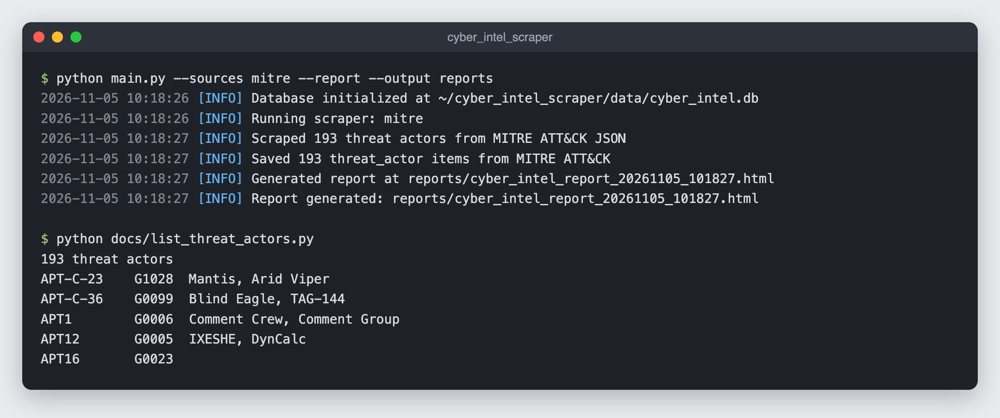
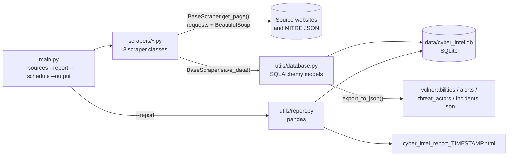
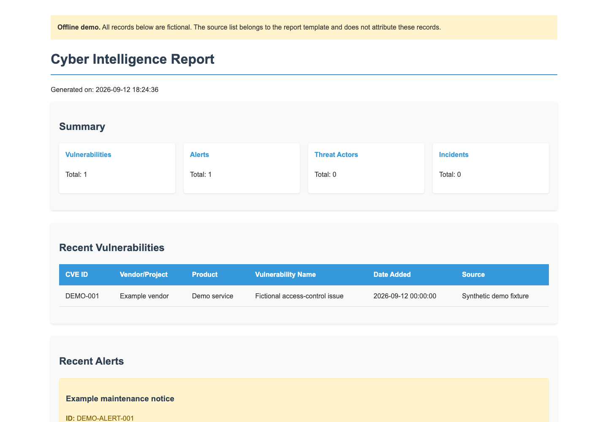

# Cyber Intelligence Scraper

A Python command-line tool that collects cybersecurity advisories, known exploited vulnerabilities and threat-actor profiles from US government, industry and academic websites, stores them in a local SQLite database, and writes an HTML summary report. It also holds the Manim animations made from this research (see [manimgl animations](#manimgl-animations)).



*A real run on 2026-11-05: the MITRE ATT&CK scraper saved 193 threat-actor groups, read back with [`docs/list_threat_actors.py`](docs/list_threat_actors.py).*

## What works today

Most of the sites this scraper was written for have since moved their pages or block scripted requests. A full `python main.py` run on 2026-11-05 (Python 3.14, from a home connection) gave:

| `--sources` key | Sites | Result on 2026-11-05 |
|---|---|---|
| `mitre` | MITRE ATT&CK (the `enterprise-attack.json` file in [mitre/cti](https://github.com/mitre/cti)) | **193 threat actors saved** |
| `us-cert` | CISA Known Exploited Vulnerabilities page, US-CERT alerts | 0 (both pages return 403) |
| `cisa-dhs` | CISA Known Exploited Vulnerabilities page, alerts, bulletins | 0 (all three return 403) |
| `fbi-cyber` | FBI cyber alerts, PINs, FLASH reports, IC3 | 0 (FBI pages 404; IC3 parsed 0 items) |
| `nsa-dod` | NSA advisories and alerts, US Cyber Command, DC3 | 0 (all return 403) |
| `nist-standards` | NIST CSF updates, NVD, NCCoE, SP 800 publications | 0 (CSF and NVD parsed 0 items; NCCoE 403; SP 800 page 404) |
| `research-academic` | SEI, CERIAS, Stanford Cyber Initiative, DARPA I2O | 0 (all four pages 404) |
| `industry-orgs` | SANS ISC, Cyber Threat Alliance, CIS, FS-ISAC, MS-ISAC, FIRST, CERT/CC | 0 (pages load but parse 0 items, or 404 / connection closed) |

CISA still publishes the same catalog as a JSON feed (`https://www.cisa.gov/sites/default/files/feeds/known_exploited_vulnerabilities.json` returned 200 the same day), so the vulnerability scrapers could be pointed there.

## How it fits together



- `main.py` builds the eight scrapers, runs the ones you pick (all by default), and optionally writes a report. `--schedule N` runs once, then again every N hours until you stop it.
- Every scraper inherits `BaseScraper`, which fetches pages with three tries and an increasing pause between them, parses HTML, and tags each record with its source and scrape time before saving.
- `Database` stores four record types in `data/cyber_intel.db`: vulnerabilities, alerts, threat actors and incidents.
- The report shows a count for each type, the 20 most recent vulnerabilities and the 10 most recent alerts.

## Setup

Tested with Python 3.14.

```sh
git clone https://github.com/cadeKukk/cyber_intel_scraper.git
cd cyber_intel_scraper
python -m venv venv
source venv/bin/activate   # Windows: venv\Scripts\activate
pip install requests beautifulsoup4 pandas python-dotenv schedule colorlog sqlalchemy
```

Those seven packages are the ones the code imports. `requirements.txt` pins 2023 versions; `pip install -r requirements.txt` fails on Python 3.14 because pandas 2.1.1 has no wheel for it and doesn't build. It also lists four packages nothing imports (tqdm, feedparser, aiohttp, pycountry). It may still work on the older Python versions those pins were made for; that hasn't been checked.

No API keys or environment variables are needed.

## Usage

```sh
python main.py                                    # run every scraper once
python main.py --sources mitre --report           # one source, then an HTML report
python main.py --sources us-cert cisa-dhs         # several sources (keys from the table above)
python main.py --schedule 24 --report             # run now, then every 24 hours
python main.py --report --output reports          # put the report in ./reports
```

- Unknown `--sources` keys are skipped without an error; if none of them is valid, the run stops and logs the list of valid keys.
- `--output` only sets where the report goes (default `data/`). The database is always `data/cyber_intel.db`.

### Reading the data

```python
from utils.database import Database

db = Database()                                   # opens data/cyber_intel.db
actors = db.get_threat_actors(limit=10)           # sorted by name
vulns = db.get_vulnerabilities(limit=10)          # optional filters: cve_id=, source=
alerts = db.get_alerts(source="US-CERT")          # newest first
paths = db.export_to_json(output_dir="exports")   # one JSON file per record type
```

`get_threat_actors` also takes `country=`, but the MITRE data doesn't include a country, so that filter currently returns nothing.

### Offline report demo



[`docs/sample-report.html`](docs/sample-report.html) is the report generator's output for one made-up vulnerability and one made-up alert, so you can see the layout without scraping anything. Regenerate it with `python docs/demo_report.py` (needs pandas only; it doesn't open the database or contact any site).

## Known issues

- Only the MITRE scraper returns data right now (see [What works today](#what-works-today)).
- Running a scraper again stores every record again: two MITRE runs leave 386 rows, not 193.
- MITRE threat actors get a `source_url` built from the STIX ID (`/groups/intrusion-set--…`), which 404s. The ATT&CK group ID (`G0006` etc.) ends up in `capabilities`; `https://attack.mitre.org/groups/G0006/` is the working link. `country`, `motivation`, `first_seen` and `last_seen` are always empty because the JSON doesn't carry them.
- No scraper writes incidents, so that table stays empty.
- The report's "Data Sources" list is fixed text and names sites this tool doesn't scrape (ENISA, NCSC, ThreatPost).
- Requests use a fixed Chrome 91 user agent and don't check robots.txt; the only delays are between retries.

## manimgl animations

`manimgl animations/` holds [3Blue1Brown manim](https://github.com/3b1b/manim) (`manimgl`) scenes built from this research. They use numbers typed into the scripts, not the database.

| File | Scenes |
|---|---|
| `CTHREAT.py` | `CyberThreatTiers`, `SimpleThreatMatrix` |
| `JCC.py` | `CyberSecurityOrgChart` (US cybersecurity organisations) |
| `cyberdif.py` | `CyberAttacksPieChart` (2024 reported incidents by type) |
| `cyberterror.py` | `CyberTerrorTargets` |
| `terror.py` | `AttackOriginsPieChart` (nation-state actors) |
| `simple_terror.py` | `CyberTerrorismScene` |
| `ters.py` | `CybersecuritySources` (source list with a QR code) |
| `run_terror.py` | Runs `simple_terror.py` through a virtualenv at a fixed path on the author's machine |
| `terror.html` | A React + Recharts dashboard component (JSX, despite the `.html` name) |

Render one with, for example, `manimgl CTHREAT.py CyberThreatTiers`.

## Project structure

```
main.py                  command-line entry point
scrapers/                BaseScraper and one module per source group
utils/database.py        SQLAlchemy models and query/export helpers
utils/report.py          HTML report
utils/logger.py          console logging (coloured in a terminal)
docs/                    offline report demo, threat-actor listing script, screenshots
manimgl animations/      Manim scenes from the same research
```

## Adding a source

Create a class in `scrapers/` that inherits `BaseScraper`, set `source_name` and `base_url`, implement `scrape()` to collect a list of dicts whose keys match the columns in `utils/database.py`, and pass them to `self.save_data(items, "vulnerability" | "alert" | "threat_actor" | "incident")`. Then add it to the `scrapers` dictionary in `run_scrapers()` in `main.py` under the key you want for `--sources`.

```python
from scrapers.base_scraper import BaseScraper

class ExampleScraper(BaseScraper):
    def __init__(self, db):
        super().__init__(db)
        self.source_name = "Example"
        self.base_url = "https://example.com"

    def scrape(self):
        soup = self.parse_html(self.get_page(self.base_url + "/advisories"))
        items = []  # build dicts with title, url, published_date, summary ...
        return self.save_data(items, "alert")
```

Check that a site allows automated access before adding it, and credit the source when you use what it publishes.
